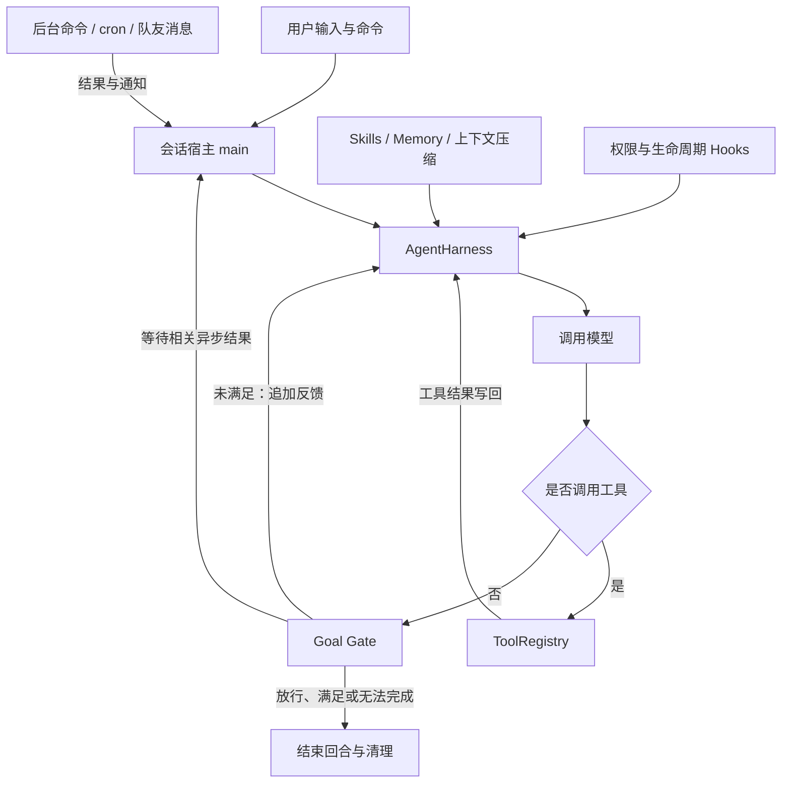

# Aki-Code

<details>
<summary>目录</summary>

1. [项目简介](#1-项目简介)
2. [运行演示](#2-运行演示)
3. [核心能力](#3-核心能力)
4. [架构设计](#4-架构设计)
5. [验证情况](#5-验证情况)
6. [快速开始](#6-快速开始)
7. [代码导航](#7-代码导航)
8. [开发记录](#8-开发记录)
9. [当前限制与后续计划](#9-当前限制与后续计划)
10. [参考与许可证](#10-参考与许可证)

</details>

## 1. 项目简介

使用 Python 实现的命令行编程 Agent。通过自然语言任务驱动模型读取代码、修改文件、执行命令和验证结果，并支持子 Agent、常驻队友、可恢复工作流和会话目标判定。

项目参考 **learn-claude-code 的 S01–S17 课程设计**逐步构建，再结合自身代码组织整合各项机制。当前默认使用 Anthropic SDK 调用 DeepSeek 的 Anthropic 兼容接口，已完成真实 API 功能联调，以及 SWE-bench Lite 300 题评测。按每题最新尝试统计，官方通过 **214/300（71.33%）**；成绩口径、失败归因和评测限制见[分析索引](analysis/README.md)与[完整报告](analysis/swebench_lite_20261020/report.md)。

## 2. 运行演示

> 待补充：真实终端录屏或 GIF，展示一次“读取代码 → 修改实现 → 运行验证 → 完成任务”的完整过程。

## 3. 核心能力

| 核心能力 | 实现方式 |
| --- | --- |
| **共享执行循环** | 主 Agent、一次性子 Agent、常驻队友和工作流步骤复用 `AgentHarness`，分别注入工具、权限与生命周期 Hook，统一处理执行结果和用量 |
| **长任务执行与完成判定** | Workflow 组织并行、流水线和可恢复步骤；Goal Gate 在主 Agent 准备结束时独立检查证据，未满足则继续，相关后台任务未完成则等待结果 |
| **任务协作** | 使用会话内 Todo 和持久化任务依赖图规划工作，通过原子认领、队友邮箱、计划审批及 Git worktree 绑定协调执行 |
| **上下文与知识管理** | Skills 按需加载，长期记忆选择性召回；大结果落盘、历史归档、结果压缩与模型摘要共同控制上下文规模 |

基础工具支持文件读取、写入、精确编辑、路径搜索及 Shell 命令执行；权限系统提供路径检查、命令规则和交互确认。MCP 支持工具动态发现与共享，当前通过进程内模拟服务验证接入机制。

## 4. 架构设计

`runtime.py` 组装共享运行时；`main.py` 承载交互入口，`headless.py` 承载非交互单任务入口。两种入口都通过 `AgentHarness` 执行模型调用、工具调度与回合生命周期。下面展示主会话的执行路径：



主 Agent、子 Agent、队友与工作流步骤复用同一个循环，并分别注入工具集合、权限回调和 Hook。子 Agent 不允许递归委派，工作流步骤采用只读工具集，Goal 判断只挂载在主会话的结束位置。

Skills 按需读取；记忆从磁盘选择性召回；大工具结果和历史消息可先归档，再压缩或生成摘要。任务、异步事件和目标状态各自维护生命周期，由宿主把需要模型处理的结果送回会话。

## 5. 验证情况

### SWE-bench Lite 300 题评测

2026-10-20 完成 `lite-baseline-001` 的 300 题评测，使用 `deepseek-flash`、SWE-bench 官方 harness 4.1.0 和 2 个 worker。运行、补丁收集与官方判分分别记录，不能用 Agent 的 `completed` 或 `limit` 状态替代测试结果。

| 统计口径 | 官方通过 | 通过率 |
| --- | ---: | ---: |
| 每题最新尝试，全部 300 题 | 214/300 | **71.33%** |
| 仅 gold 在本次环境通过的子集 | 214/295 | 72.54% |

86 道未通过题中，5 道被 gold 验证阻断，5 道因 API 流式断连未产生补丁，2 道因 runner 不支持子模块工作区而启动失败；另有 17 道出现末轮仅含 thinking、输出恰好达到 4096 token 后被记录为 `completed` 的现象，疑似输出截断，仍需保存原始 `stop_reason` 后验证。Gold 失败发生在回归测试，涉及本次环境或外部服务假设，不能直接认定参考补丁错误。其他题目的补丁失败、轮数耗尽及次要因素见[逐题归因报告](analysis/swebench_lite_20261020/report.md)。

这是本次运行条件下的观测成绩，**不作为严格 pass@1 或受控离线修复能力成绩**：共保存 326 次流水线尝试，26 题曾重跑，其中只有 2 题实际运行过两次 Agent，旧补丁的判分仍有缺失；部分成功题还下载、读取了后续发行版本的源码或测试资料。报告单列了重试、额外资料访问和环境问题，未将排除样本自动计为成功。

核心报告、逐题 Excel、完整分析 ZIP 及校验值统一见[分析索引](analysis/README.md)。原始测试数据另以 ZIP 保存在本地 `.task_outputs/archives/`，由 Git 忽略，不随仓库发布。

### 功能与评测链路联调（历史记录）

2026-10-18 使用现有配置的 `deepseek-flash`，在 Windows / Python 3.12.4 上完成了一轮真实 API 联调：

| 验证项 | 结果 |
| --- | --- |
| 真实 API 场景 | 11 组场景，最终 52 项检查通过 |
| 针对性本地回归 | 13 项检查通过 |
| Python 语法检查 | 94 个模块通过 |

联调覆盖代码读取与修复、固定测试的失败与重跑、Goal 证据拦截、后台唤醒与 cron 隔离、队友计划审批、Workflow 独立核验与缓存恢复、上下文压缩、记忆落盘与全新对话召回、MCP 工具向子 Agent 共享，以及用量核对。Goal 拦截与上限恢复包含受控工具选择测试，MCP 场景使用现有模拟服务。

包括初次失败和复测，共发出 175 次 API 请求。这是单轮功能验证记录，不能换算为真实代码修复任务的成功率；该次联调未包含 SWE-bench Lite 评测。

上述联调的临时驱动已清理，原始报告和日志保存在本地 `.task_outputs/`，不随 Git 发布。非交互入口另通过 28 项离线检查，使用临时 Git 仓库和本机模拟 API，覆盖完整 CLI、权限、共享限额、后台续轮、Goal、超时清理和补丁还原；相关测试驱动在验证后清理，仓库当前不提供长期维护的自动化测试套件或 CI。

2026-10-19 对新增的非交互入口进行真实 API 冒烟验证：在独立的小型仓库中先观察测试失败，修复加法函数，再确认三个固定测试通过、测试文件未修改，最终由 Goal 判断器返回 `achieved` 并导出补丁。该成功运行使用 7 次模型请求、18,835 Token；这是入口功能检查，未计入上方 S17 联调统计，也不构成 benchmark 成绩。

同日完成 WSL Ubuntu 26.04 / Python 3.14.4 验证：28 项离线回归与 14 项针对性检查通过，真实 API 覆盖子 Agent、后台测试、Goal 和补丁重放。随后使用 SWE-bench 4.1.0，在 Docker 中跑通 Lite 的 `sympy__sympy-20590`：Agent 正常结束，官方判定 `resolved: true`，1 项 FAIL_TO_PASS 和 21 项 PASS_TO_PASS 全部通过。最终运行使用 12 次模型请求、108,386 Token，Goal 关闭。该题经过环境调试和运行时修复后的复测，仅用于验证单题链路，不构成固定配置下的全量评测成绩。临时驱动已清理，报告、日志和补丁保留在本地 `.task_outputs/wsl-20261019/`。

随后补充可保留的 SWE-bench 评测驱动，29 项临时回归检查通过。使用新驱动再次完成该题的真实 API 与官方判分：Agent 触及 300,000 Token 软阈值，以 `limit` 结束，已导出的补丁仍获得官方 `resolved: true`，1 项 FAIL_TO_PASS 和 21 项 PASS_TO_PASS 全部通过；本次使用 28 次模型请求、303,868 Token。另验证了不调用模型的补丁判分恢复与按题续跑。以上仍是同一道题的开发验证，不能作为全量成绩或 pass@1 结果；该轮验证环境为 x86_64 WSL。

针对 MacBook 试跑暴露的权限中断问题，改用专用测评权限与 runner 独立补丁收集，29 项临时回归和 Docker 超时收集、补丁重放检查通过。再次用真实 API 验证同题，Agent 达到 250,000 Token 软阈值后以 `limit` 停止；runner 独立收集的补丁获得官方 `resolved: true`，1 项 FAIL_TO_PASS 和 21 项 PASS_TO_PASS 全部通过，使用 27 次模型请求、260,114 Token。该次仍为 WSL 下的开发验证，新版本需要在 Mac 重新试跑。

## 6. 快速开始

需要 **Python 3.10+** 和可用的 DeepSeek API Key。使用 Git worktree 功能时，需要在 Git 仓库中运行。

### Windows PowerShell

在项目根目录执行：

```powershell
python -m venv .venv
.\.venv\Scripts\python.exe -m pip install -r requirements.txt
Copy-Item .env.example .env
```

编辑 `.env`，填入自己的 API Key：

```dotenv
DEEPSEEK_API_KEY=your-api-key-here
DEEPSEEK_BASE_URL=https://api.deepseek.com/anthropic
MODEL_NAME=deepseek-flash
```

然后启动：

```powershell
.\.venv\Scripts\python.exe -m aki_code.main
```

### Linux / WSL

```bash
python3 -m venv .venv
.venv/bin/python -m pip install -r requirements.txt
cp .env.example .env
# 编辑 .env，填写上面的 API 配置
.venv/bin/python -m aki_code.main
```

启动时的当前目录作为默认工作区。Windows 下 Shell 工具使用 `cmd.exe`，Linux / WSL 下使用 `/bin/sh`；模型提示会报告实际执行环境。

### 第一次任务

启动后可以直接描述任务：

```text
先查看项目结构，解释主 Agent、子 Agent 和队友如何复用执行循环。
```

默认模式下，文件修改需要确认。可以在会话中切换工作区内的编辑权限：

```text
/mode accept-edits
```

此模式自动接受允许目录内的文件编辑，Shell 命令规则和其他权限检查仍然生效。

### 非交互执行一个任务

适合在 WSL、Docker 或服务器上由脚本启动任务。准备一个已有提交且干净的 Git 仓库，以及 UTF-8 编码的任务文件：

```powershell
.\.venv\Scripts\python.exe -m aki_code.main run `
  --task-file E:/tasks/task.txt `
  --workspace E:/tasks/repo `
  --output-dir E:/runs/task-001 `
  --permission-mode accept-edits `
  --max-turns 30 --max-calls 60 --max-tokens 100000 --timeout 600
```

Linux / WSL 使用相同参数，例如：

```bash
.venv/bin/python -m aki_code.main run \
  --task-file /tasks/task.txt --workspace /tasks/repo \
  --output-dir /runs/task-001 --permission-mode accept-edits
```

`--task "任务描述"` 与 `--task-file` 二选一；任务文本直接交给模型，内容中的 `/goal` 等字符串不会触发 CLI 命令。需要独立完成判断时，另传 `--goal "验证命令退出码为 0"`。

| 参数 | 默认值 / 要求 | 含义 |
| --- | --- | --- |
| `--workspace` | 必填 | 干净的 Git 仓库根目录，包含至少一个提交；暂不支持子模块 |
| `--output-dir` | 必填 | 工作区外的新目录，不覆盖已有运行结果 |
| `--permission-mode` | `default` | 可选 `accept-edits`；遇到需要人工确认的操作时返回 `blocked` |
| `--max-turns` | `30` | 整个任务的主 Agent 模型轮数，后台及 Goal 续轮累计计数 |
| `--max-calls` | `60` | 全部模型请求尝试次数，包含子 Agent、摘要、Goal 判断和重试 |
| `--max-tokens` | `100000` | 所有已收到响应的 Token 软阈值，包含缓存 Token；单次在途请求可能超出 |
| `--timeout` | `600` | 工作进程总时限，单位秒，包含 API、工具及后台等待；退出后另做清理和补丁导出 |
| `--goal` | 不启用 | 可选的、可验证的完成条件 |

首版提供文件读写、路径搜索、Shell、Todo、技能、上下文压缩和一次性子 Agent，共九个基础工具。支持后台 Shell；不开放 cron、常驻队友、MCP 和 Workflow。默认关闭长期记忆的召回与提取，每次运行使用全新会话，状态和历史归档保存到输出目录的 `state/` 中。

本次运行的工具输出和历史归档支持受限只读访问，可通过 `glob` 查找文件，并用 `read_file` 的 `offset`（从 1 开始的行号）和 `limit` 分页读取。归档目录的文件修改和 Shell 访问会被拦截。

| 产物 | 内容 |
| --- | --- |
| `result.json` | 最终状态、退出码、原因、基准提交、配置、耗时和模型用量 |
| `events.jsonl` | 请求、工具、Goal 与后台任务事件；包含运行过程中的消息 |
| `messages.json` | 最近保存的主会话上下文；压缩前的消息可查事件及归档 |
| `patch.diff` | 相对初始提交的 Git 补丁，包含新增、删除和二进制文件 |
| `run.log` | 可读的运行日志 |
| `request.json` / `progress.json` | 启动输入与用量检查点；不表示支持会话恢复 |

标准输出只返回一份结果 JSON，过程日志写到标准错误和 `run.log`。`completed` / `achieved` 退出码为 `0`，`failed` / `error` / `goal_error` 为 `1`，`blocked` 为 `2`，`limit` 为 `3`，`timeout` 为 `124`，用户中断为 `130`。

普通停止返回 `completed`；启用 Goal 后，由判断器返回 `achieved` 或 `failed`。这些状态说明 Agent 的运行结果，**不能代替 SWE-bench 官方测试的通过结果**。失败、限额和超时时也尽量导出已有补丁。导出使用临时 Git index，不提交、不重置、不暂存用户的真实工作区。运行会直接修改指定仓库，建议每道题使用独立 checkout 或容器；权限检查本身不是操作系统沙箱。

### SWE-bench Lite 评测

仓库提供独立的 [SWE-bench 评测驱动](benchmarks/swebench/README.md)，使用固定的官方评测器，在 Linux Docker 容器中运行 Agent 并独立判分。支持单题、固定抽样、全量执行、按题并行、按题续跑和单独重试判分。MacBook / Mac mini 的安装、Docker 架构要求和完整操作步骤见该文档。

安装评测依赖并配置 API 后，在项目根目录执行：

```bash
python -m benchmarks.swebench doctor
python -m benchmarks.swebench run --output-dir .task_outputs/swebench/smoke
```

默认仅验证并运行 `sympy__sympy-20590`，会调用真实 API；完整 300 题需要显式指定 `--all`。运行记录和补丁保存到输出目录，`summary.json` 中的官方解决率以本次选中全部题目为分母。Apple Silicon 使用 x86_64 Linux 镜像兼容执行，需要在目标设备先做单题验证。

SWE-bench 默认预算为每题主 Agent 60 轮、全部模型请求 80 次、1,000,000 Token 软阈值，Agent 执行时限为 600 秒；可用命令行参数覆盖。预算写入新运行的清单，续跑沿用原运行保存的配置。

默认串行执行；加 `--workers 2` 可同时运行两道题，空位自动补入后续题目。每题使用独立进程和容器，由主进程统一汇总结果；续跑自动沿用清单中的并发数。

测评模式允许在题目工作区和专用临时目录中开展修复，权限拒绝先作为工具结果反馈给模型，连续三次同类拒绝才停止。Agent 停止后，外部 runner 独立收集 Git 改动，不依赖模型生成补丁或 Agent 写出结果文件；汇总分别记录 Agent 状态、补丁状态和官方判分。普通非交互入口仍默认自行导出补丁。此版测评清单升级为 v2，请使用新的输出目录，旧结果可继续只读查看。

<details>
<summary>任务执行示例：Goal、Workflow、队友与后台任务</summary>

### 用 Goal 明确完成条件

```text
/goal 检查并修复 aki_code 中的语法错误，直到 python -m compileall -q aki_code 退出码为 0
/goal
/goal clear
```

`/goal 条件` 设置当前会话唯一的目标并立即开始执行。完成条件应写明预期状态、验证命令和限制，例如必须保留哪些接口、不能修改哪些测试。

主 Agent 准备结束时，Goal Gate 使用一次独立、无工具的模型调用检查当前目标的对话证据：

| 判断结果 | 后续行为 |
| --- | --- |
| 条件满足 | 结束目标，保留状态供查看 |
| 尚未满足 | 把具体缺口追加回同一份对话，主 Agent 自动继续 |
| 相关异步任务未完成 | 暂缓判断，等待后台或队友结果投递后唤醒 |
| 约束下无法完成 | 结束目标并说明原因 |
| 达到限制、调用失败或用户中断 | 保留目标，停止自动续轮，等待用户输入 |

判断器只能读取记录，实际验证由工具执行。主模型的声明、队友总结或 Workflow 完成状态本身不能证明测试通过。压缩前的近期原始记录会有界保留，超长内容标注为不完整证据。

`/goal` 仅查看状态；新的 `/goal 条件` 会替换旧目标；`/goal clear` 只清除完成条件，已启动任务仍由原有生命周期管理。`stop`、`off`、`reset`、`none`、`cancel` 也可作为清除别名。目标暂停后，输入新消息或按回车可继续。

Goal 只作用于主会话。旧目标的后台结果不会自动推进替换后的目标，无关的 cron 投递也不会触发 Goal 判断。

### 执行和恢复工作流

内置 `review-changes` 工作流按多个维度审查代码，再独立核验候选问题，最后去重排序。可以直接使用命令：

```text
/workflows list
/workflows run review-changes {"changes":"检查 aki_code/goal 中的代码","dimensions":["correctness","error handling"]}
/workflows runs
/workflows show RUN_ID
/workflows resume RUN_ID
```

也可以让主 Agent 先收集实际变更，再调用工作流：

```text
读取当前工作区的 git diff，把完整 diff 作为 changes 参数交给 review-changes，检查正确性和异常处理。
```

`changes` 接受固定 diff 或明确的源码范围。完整 diff 提供变更前后的证据；仅给文件范围时，工作流检查当前源码。审查步骤只提供仓库内受限读取和路径搜索，报告明确标注 `tests_executed: false`；需要运行测试时，由主 Agent 另行执行验证命令。

工作流外层同步等待，内部执行受并发上限约束。状态快照、成功步骤日志与最终报告保存到 `.workflows/`。恢复时核对流程版本、参数、工具与模型配置、工作区快照，以及读取文件的内容 hash；只复用成功且校验通过的步骤。输入变化后需要发起新运行。

Ctrl+C 会取消新步骤的调度，等待正在执行的请求收尾后保存状态。`usage` 表示本次运行或恢复的消耗，`total_usage` 表示该运行的历史累计消耗；每次恢复重新计量本次预算。

### 队友与后台任务

一次性子 Agent 通过 `task` 工具处理独立子任务，拥有单独对话，向主 Agent 返回最终摘要。常驻队友绑定持久化任务，跨任务保留自己的对话，通过文件邮箱与主 Agent 通信。

主 Agent 的提示要求先提出团队分工并获得用户确认，再启动队友。启用 `require_plan` 后，队友需先提交计划；批准前，Shell、文件编辑和任务完成工具均被拦截。等待审批时保留任务认领与工作目录，收到审批回复后继续。需要并行修改不同任务时，可以绑定独立的 Git worktree；创建 worktree 需要确认。

耗时命令可以通过 `bash` 工具的 `run_in_background` 参数在后台执行。完成输出作为通知进入会话，相关目标可自动续跑。cron 支持五字段表达式、单次或重复任务、可选持久化；CLI 进程需要保持运行才能触发任务，不补跑离线时段。

后台、cron 和团队事件触发的自动回合不读取终端询问权限，需要交互确认的操作会被拒绝并返回说明。

</details>

<details>
<summary>常用命令</summary>

| 命令 | 用途 |
| --- | --- |
| `/help` | 列出命令 |
| `/mode [default\|accept-edits]` | 查看或切换权限模式 |
| `/goal [条件\|clear]` | 设置、查看或清除会话目标 |
| `/workflows [list\|run\|runs\|show\|resume]` | 执行、查看或恢复工作流 |
| `/todo` | 查看当前会话的 Todo |
| `/tasks` | 查看持久化任务列表 |
| `/skills` | 查看可加载的技能 |
| `/memory` | 查看已保存的记忆 |
| `/mcp` | 查看 MCP 服务和连接情况 |
| `/compact [重点]` | 主动压缩上下文，可指定摘要重点 |
| `/hooks [on\|off\|status]` | 控制 Hook 日志显示 |
| `/usage` | 查看会话模型调用数及 Token 消耗 |
| `/exit` | 退出并清理运行中的组件 |

任务创建、依赖关系、队友操作和 cron 管理由模型工具完成；CLI 命令用于会话控制与状态查看。`/usage` 汇总主 Agent、子 Agent、队友、工作流、Goal 判断及记忆和摘要调用；`/goal` 单独显示当前目标的主 Agent 与判断器用量。

</details>

<details>
<summary>配置与本地状态</summary>

配置从环境变量与 `.env` 加载。完整参数见 `aki_code/config.py`。

| 配置 | 默认值 | 含义 |
| --- | --- | --- |
| `DEEPSEEK_API_KEY` | 必填 | DeepSeek API Key |
| `DEEPSEEK_BASE_URL` | `https://api.deepseek.com/anthropic` | Anthropic 兼容接口地址 |
| `MODEL_NAME` | `deepseek-flash` | 执行模型 |
| `MAX_TOKENS` | `4096` | 主 Agent 等执行调用的单次输出上限 |
| `MAX_TURNS` | `0` | 主会话模型轮数上限；`0` 为不设置，Goal 等待异步结果后继续仍计入同一续轮链 |
| `MAX_STOP_BLOCKS` | `10` | Goal 连续阻止结束的次数上限，达到后保留目标并交还用户 |
| `GOAL_EVALUATOR_MODEL` | 与 `MODEL_NAME` 相同 | 独立判断器模型，共用当前 API 接口 |
| `GOAL_EVALUATOR_MAX_CHARS` | `24000` | 判断请求中条件与对话材料的字符预算 |
| `GOAL_EVALUATOR_TIMEOUT` | `60` | 判断请求超时，秒 |

<details>
<summary>工作流、上下文与后台任务参数</summary>

| 配置 | 默认值 | 含义 |
| --- | --- | --- |
| `WORKFLOW_MAX_CONCURRENCY` | `3` | 工作流并发模型调用上限 |
| `WORKFLOW_MAX_CALLS` | `60` | 一次执行或恢复的调用次数上限，包含重试与格式修复 |
| `WORKFLOW_MAX_TURNS` | `12` | 单个工作流 Agent 步骤的模型轮数上限 |
| `WORKFLOW_MAX_TOKENS` | `100000` | 一次执行或恢复的 Token 软阈值 |
| `WORKFLOW_REQUEST_TIMEOUT` | `120` | 工作流单次请求超时，秒 |
| `CONTEXT_CHAR_LIMIT` | `50000` | 上下文压缩的字符预算，按字符估算 |
| `MAX_MESSAGES` | `50` | 触发历史消息归档裁剪的消息数量阈值 |
| `TOOL_RESULT_BUDGET_CHARS` | `200000` | 最新工具结果批次的字符预算 |
| `BACKGROUND_JOB_TIMEOUT` | `600` | 后台命令超时，秒 |
| `BACKGROUND_MAX_OUTPUT_CHARS` | `200000` | 后台任务结果保留的字符上限 |

Token 在请求完成后统计，并发在途请求可能使工作流总量超过软阈值；调用次数与并发上限在请求调度时约束。

</details>

<details>
<summary>本地状态与目录</summary>

| 默认路径 | 配置项 | 保存内容 |
| --- | --- | --- |
| `skills/` | `SKILLS_DIR` | 技能目录，每个技能提供 `SKILL.md` |
| `.memory/` | `MEMORY_DIR` | 长期记忆及索引 |
| `.tasks/` | `TASKS_DIR` | 任务状态、依赖、认领与 worktree 绑定 |
| `.scheduled_tasks.json` | `SCHEDULES_FILE` | 持久化 cron 定义 |
| `.mailboxes/` | `MAILBOX_DIR` | Agent 间消息 |
| `.worktrees/` | `WORKTREES_DIR` | 任务绑定的 Git worktree |
| `.workflows/` | `WORKFLOWS_DIR` | 工作流快照、步骤日志和报告 |
| `.transcripts/` | `TRANSCRIPTS_DIR` | 压缩前的历史归档 |
| `.task_outputs/tool-results/` | `TOOL_OUTPUTS_DIR` | 落盘的工具结果 |

生成的状态目录已由 `.gitignore` 排除。完整会话和活跃 Goal 不会在 CLI 启动时自动恢复；压缩归档也不等同于会话恢复。`GoalController.restore()` 为宿主提供恢复活跃完成条件的接口，恢复后清空旧证据、计数和用量，等待用户输入。已完成、失败或清除的目标不会重新启动。

</details>

</details>

## 7. 代码导航

```text
aki_code/
├── main.py           # 交互 CLI 与入口路由
├── runtime.py        # 两种入口共享的会话组装与生命周期
├── headless.py       # 单任务执行、工作进程监督与超时
├── execution.py      # 跨主 Agent / 子 Agent / 辅助调用的限额
├── artifacts.py      # 运行记录、结果与独立 index 补丁导出
├── config.py         # 环境配置
├── agent/            # 共享 Harness、一次性子 Agent、回合结果
├── tools/            # 编程、任务、团队与工作流工具
├── commands/         # Slash 命令
├── hooks/            # 生命周期、日志与耗时
├── security/         # 路径、命令规则与确认策略
├── llm/              # API 客户端、提示、重试与用量
├── compact/          # 上下文归档与压缩
├── skills/           # 技能发现与按需加载
├── memory/           # 长期记忆的提取、召回与整理
├── todo/             # 会话内 Todo
├── tasks/            # 持久化任务图
├── background/       # 后台进程与结果通知
├── scheduler/        # cron 表达式、存储与调度
├── team/             # 常驻队友、消息、计划审批与 worktree
├── mcp/              # 服务发现、工具适配与宿主授权
├── workflow/         # 保存的流程、受限 Runner、预算与恢复
└── goal/             # 会话目标、独立判断器与 Stop Gate
skills/              # 项目提供的技能
```

## 8. 开发记录

项目沿 S01–S17 逐步增加能力。下面的主题按本项目实现归纳，代码入口指向当前版本；早期循环和权限等机制已在后续阶段整合进共享 Harness。

| 阶段 | 主题 | 本项目实现 | 当前代码入口 |
| --- | --- | --- | --- |
| **S01** | Agent Loop | 建立模型调用、工具结果写回与继续执行的基本循环 | `aki_code/agent/harness.py` |
| **S02** | 工具调用 | 实现文件与 Shell 工具，统一工具定义、注册和分发 | `aki_code/tools/` |
| **S03** | 权限控制 | 增加路径检查、命令规则、交互确认和编辑权限模式 | `aki_code/security/permission.py` |
| **S04** | 生命周期 Hooks | 为模型调用、工具执行、错误与结束等事件提供扩展点 | `aki_code/hooks/` |
| **S05** | Todo 规划 | 通过 Todo 工具维护当前会话的步骤与进度 | `aki_code/todo/manager.py` |
| **S06** | 一次性子 Agent | 使用独立对话处理子任务，向主 Agent 返回最终摘要 | `aki_code/agent/subagent.py` |
| **S07** | Skills | 扫描技能目录，先加载目录信息，再按需读取完整指令 | `aki_code/skills/loader.py` |
| **S08** | 上下文压缩 | 增加工具结果落盘、历史归档、结果压缩、摘要与请求过长恢复 | `aki_code/compact/compactor.py` |
| **S09** | 长期记忆 | 实现记忆提取、分类存储、模型选择、召回与整理 | `aki_code/memory/store.py` |
| **S10** | 持久化任务图 | 支持任务创建、依赖关系、原子认领、完成与释放 | `aki_code/tasks/store.py` |
| **S11** | 后台任务 | 后台执行耗时命令，回收输出与退出码并投递完成通知 | `aki_code/background/manager.py` |
| **S12** | cron 调度 | 实现五字段表达式、任务持久化、定时投递与失败重投 | `aki_code/scheduler/` |
| **S13** | 常驻队友与工作目录 | 增加文件邮箱、队友运行时、计划审批和任务 worktree 绑定 | `aki_code/team/` |
| **S14** | MCP 工具接入 | 实现服务发现、工具适配、前缀命名与宿主授权，当前以模拟服务验证 | `aki_code/mcp/` |
| **S15** | Integrated Harness | 将主 Agent、子 Agent 和队友迁入共享循环，通过 Hook 接入权限并共享已连接的 MCP 工具 | `aki_code/agent/harness.py`、`aki_code/main.py` |
| **S16** | 保存的工作流 | 增加并行与流水线执行、结构化输出校验、预算、持久化与输入校验恢复 | `aki_code/workflow/` |
| **S17** | Goal Loop | 增加会话目标和独立结束判断，支持自动续轮、异步等待、限制与错误出口 | `aki_code/goal/` |

### 真实 API 联调后的修订

S17 完成后进行真实 API 联调，修复了队友等待审批时误报完成、辅助模型调用输出耗尽、Windows 中文输出解码失败，以及记忆和摘要调用用量漏算等问题。验证范围与结果见第 5 部分。

随后补充非交互 `run` 入口，提取共享 `AgentRuntime`，增加跨调用限额、进程超时监督、独立运行记录和 Git 补丁导出，为后续评测适配提供单任务执行能力。

Linux 与 SWE-bench 单题联调进一步修复了归档输出被误判为越界访问，以及 Shell 重定向后的分隔符被计入路径的问题；增加归档只读取回、文件分页读取，并检查路径搜索模式的访问范围。

评测适配独立放在 `benchmarks/swebench/`，通过现有非交互入口连接 Docker 题目环境与官方判分器，提供源码和数据快照、单题与多进程批量执行、按题续跑、判分恢复及完整选择集统计。

MacBook 试跑日志暴露出临时目录访问触发审批后过早停止的问题。后续增加专用测评权限与拒绝反馈，并将最终补丁收集交给外部 runner；Agent 运行、补丁收集与官方测试分别记录，镜像阶段也保留首次查询失败的日志和有限连接重试。

2026-10-20 完成 SWE-bench Lite 300 题运行与结果分析。公开目录保留核心报告、逐题 Excel 和完整分析 ZIP；原始运行数据单独留档在本地。失败机制和后续验证方向见[分析索引](analysis/README.md)。

## 9. 当前限制与后续计划

### 当前限制

- **MCP**：已有动态工具发现与授权机制，`docs`、`deploy` 为进程内模拟服务，尚未接入外部 MCP 传输。
- **执行环境**：Shell 命令在宿主机执行。路径与命令规则提供权限检查，未提供操作系统级隔离。
- **工作流审查**：仅执行受限只读审查，不运行测试；不同标题描述同一缺陷时，仍可能存在语义重复。
- **持久化**：支持任务、记忆、持久化 cron 定义和工作流结果落盘，完整对话及 Goal 尚无 CLI 自动恢复。
- **评测口径与稳定性**：已有 300 题全量观测结果，但包含流水线重试、外部资料访问和环境阻断，尚未形成严格 pass@1 的受控基线。疑似 thinking 输出截断、API 流式断连恢复、子模块工作区兼容和 gold 测试条件仍需处理，具体证据见[评测分析](analysis/swebench_lite_20261020/report.md)。
- **跨平台评测**：已有 x86_64 WSL 和 ARM MacBook 的试跑记录；Mac 使用 x86_64 Linux 镜像兼容执行，更新后仍需在目标设备确认兼容性和资源占用。

### 后续计划

依据本轮评测，优先推进以下工作；这些方向尚未实现，需通过独立复测确认效果：

1. 保存模型原始停止原因，验证仅 thinking／输出截断时的结束判断与恢复，先复测 17 道相关空补丁题。
2. 按失败原因恢复 API 中断、子模块启动失败及 gold 环境阻断，区分 Agent 重跑和仅重新判分，并保留每次尝试与成本。
3. 针对 60 轮后仍无补丁的探索行为，以及目标测试或回归测试未通过的补丁，改进修改落地与验证流程。
4. 补齐两份历史补丁的判分，明确联网资料访问边界，固定评测条件后建立可比较的首轮基线。

## 10. 参考与许可证

机制设计参考 learn-claude-code 课程；具体模块划分、宿主集成和功能取舍以本项目实现为准。

项目使用 Apache-2.0 许可证，详见 [LICENSE](LICENSE)。
